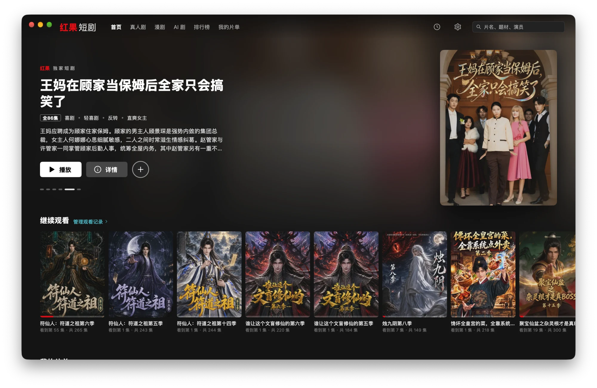
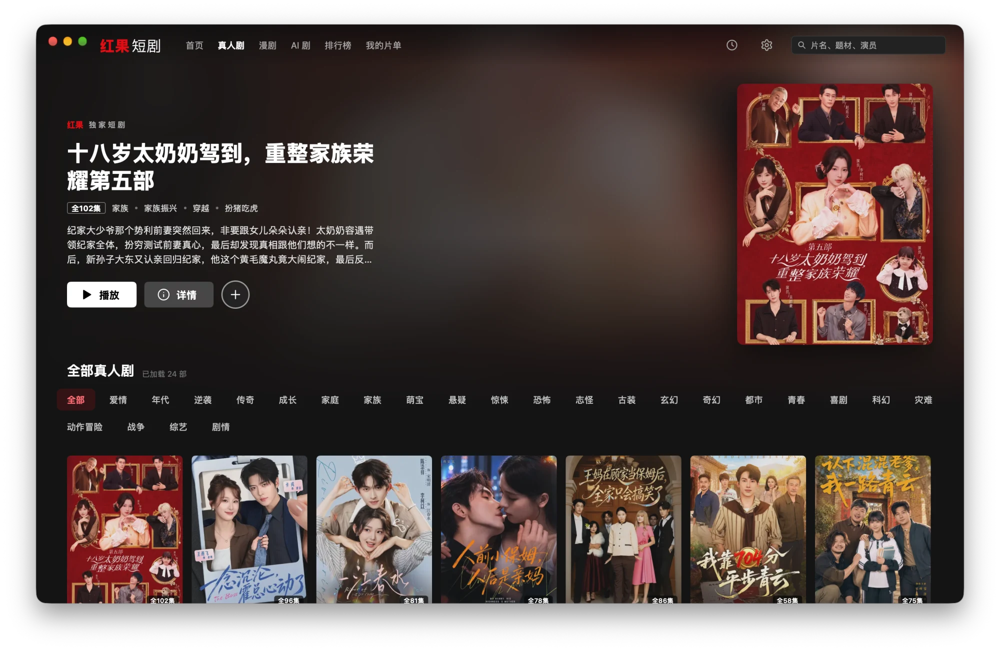
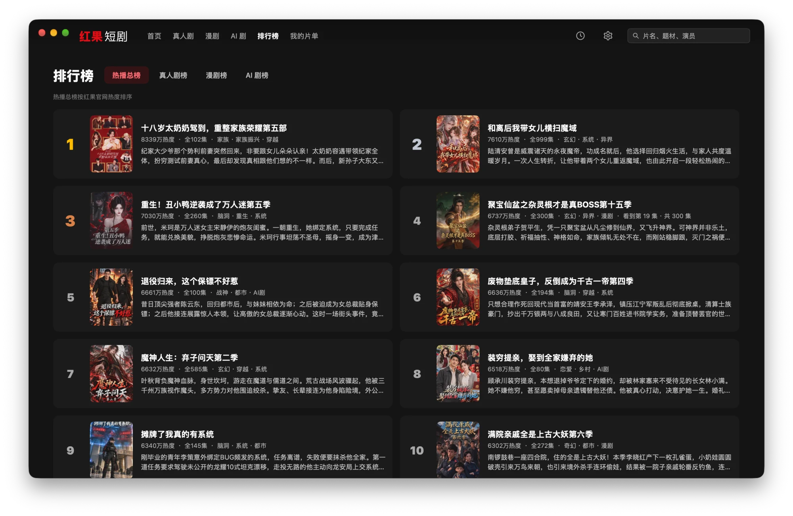

> [!IMPORTANT]
> 本项目与红果短剧及其运营方无任何关联，仅供学习交流，内容版权归原平台所有。

<div align="center">


# smovie

**为短剧而生的原生桌面播放器**

流媒体式的浏览体验 · 无缝连播 · 官方弹幕

[](https://github.com/ZainCheung/smovie/releases/latest)
[](#安装)
[](go.mod)
[](LICENSE)



<table>
  <tr>
    <td></td>
    <td></td>
  </tr>
  <tr>
    <td></td>
    <td></td>
  </tr>
</table>

</div>

## 特性

- **原生界面**：不是套壳网页，界面由原生 UI 绘制，启动快、占用低
- **流媒体式浏览**：轮播大图、海报行、真人剧 / 漫剧 / AI 剧分类与题材筛选、热播榜单
- **无缝连播**：提前载入下一集，切集零黑屏；支持自动连播与续播进度
- **官方弹幕**：弹幕悬浮于画面之上，支持表情
- **系列剧**：自动找齐一部剧的所有季，一键追整个系列
- **观看记录与我的片单**：随时继续观看，收藏想看的剧
- **称手的播放器**：清晰度选择、倍速、长按 2 倍速、全屏，全套键盘快捷键
- **离线缓存**：片库与封面本地缓存，视频缓存大小可调

## 安装

从 [Releases](https://github.com/ZainCheung/smovie/releases/latest) 下载对应平台的安装包：

| 平台 | 安装包 |
| --- | --- |
| macOS（Apple 芯片 / Intel） | `.dmg`，已签名并公证 |
| Windows（x64 / ARM64） | `smovie-setup-*.exe` |
| Linux（x64 / ARM64） | `.deb` 或 `.tar.gz` |

## 快捷键

| 按键 | 操作 | 按键 | 操作 |
| --- | --- | --- | --- |
| `Space` | 播放 / 暂停（长按 2 倍速） | `F` | 全屏 |
| `←` `→` | 后退 / 快进 5 秒（长按 `→` 2 倍速） | `D` | 弹幕开关 |
| `Shift` + `←` `→` | 上一集 / 下一集 | `M` | 静音 |
| `↑` `↓` | 音量 | `[` `]` / `\` | 减速 / 加速 / 恢复 1x |

## 从源码构建

需要 [Go](https://go.dev) 1.27+ 和 [Bun](https://bun.sh)。

```bash
bun install
bun run dev     # 开发模式
bun run build   # 打包到 build/
```

基于 [MyGo](https://github.com/egoist/mygo) 构建：界面全部是原生 UI，只有视频画面在 WebView 中播放。

## 许可证

[GPL-3.0](LICENSE)
